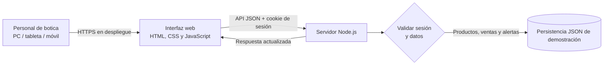
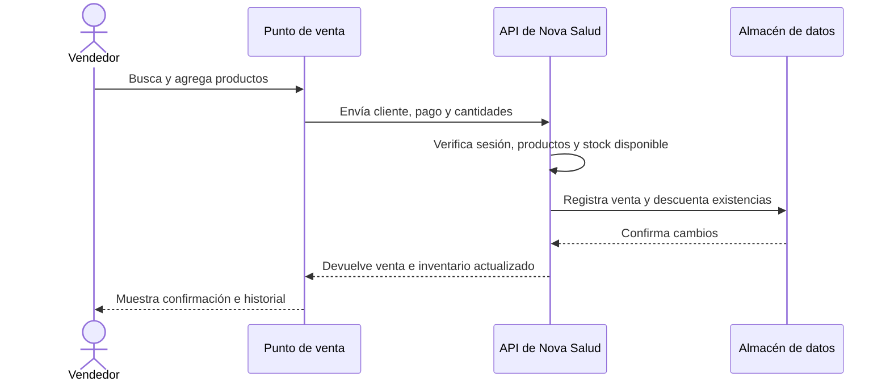

# Nova Salud — Sistema web de gestión de botica

Aplicación web de demostración para centralizar inventario, ventas y atención al cliente de la botica Nova Salud. La interfaz es adaptable a computadora, tableta y móvil.

## Iniciar la aplicación

Requiere Node.js 20 o superior. No necesita instalar dependencias.

```powershell
npm start
```

Abre `http://127.0.0.1:3000`. Acceso de demostración: **admin** / **NovaSalud2026!**. Al iniciar, el servidor crea `data/store.json` y `data/users.json` vacíos si aún no existen. El catálogo y las ventas se guardan en `data/store.json`; las cuentas de personal, con sus contraseñas protegidas mediante scrypt, se guardan en `data/users.json`. Estos archivos locales no se incluyen en Git.

Para cambiar las credenciales de demostración antes de iniciar el servidor:

```powershell
$env:BOTICA_USER = "administrador"
$env:BOTICA_PASSWORD = "una-clave-segura"
npm start
```

El administrador existente se configura con `BOTICA_USER` y `BOTICA_PASSWORD`; no se crea ni se puede registrar otro administrador. Desde la pantalla de inicio se pueden registrar cuentas de personal con rol **Vendedor**. La asignación del rol se fija y valida en el servidor, y el usuario y la contraseña deben ser únicos y tener una contraseña de al menos 10 caracteres.

La demostración usa persistencia en archivos JSON y una cuenta administrativa configurada por entorno. Para operar con datos reales, se recomienda migrar a una base de datos transaccional, habilitar HTTPS, copias de seguridad y auditoría.

## Alcance funcional

- **Inventario:** catálogo, búsqueda por nombre/código/lote, filtro por stock, alerta de stock mínimo, vencimientos próximos y registro de productos.
- **Punto de venta:** búsqueda rápida, carrito, identificación opcional del cliente, medios de pago, cálculo del total y validación de stock en el servidor.
- **Registro de ventas:** historial con fecha, cliente, productos, monto y medio de pago.
- **Actualización de stock:** cada venta descuenta existencias en el servidor; no permite vender más unidades de las disponibles.
- **Seguridad básica:** sesión en cookie HttpOnly y SameSite, contraseñas verificadas mediante scrypt, validación en servidor, respuestas sin caché y cabeceras de seguridad.

## Arquitectura



## Flujo de venta



## Propuesta para el caso práctico

El sistema sustituye el registro manual por un catálogo central y un punto de venta conectado al inventario. La validación de stock sucede en el servidor, por lo que un error en la interfaz no puede registrar una venta con cantidades negativas o superiores a la existencia. Los productos que alcanzan su nivel mínimo aparecen en el panel para facilitar la reposición. El diseño mantiene las tareas frecuentes —búsqueda, agregado al carrito, cobro y alertas— visibles y con pocos pasos.

### Respuestas a las preguntas guía

1. **Desafíos operativos:** errores de digitación y conteo, falta de visibilidad del stock real, desabastecimiento, vencimientos no detectados, demora en ubicar productos y ausencia de un historial fiable para tomar decisiones.
2. **Características necesarias:** catálogo con búsqueda rápida, stock por producto y nivel mínimo configurable, alertas, datos de lote y vencimiento, registro de ventas, medios de pago, historial, actualización de existencias y acceso seguro desde navegador.
3. **Impacto esperado:** el descuento automático tras cada venta mejora la concordancia entre el sistema y las existencias; las alertas anticipan compras y la búsqueda en el punto de venta reduce el tiempo de atención. El impacto se debe medir comparando una línea base con los resultados posteriores al despliegue.
4. **Beneficios adicionales:** trazabilidad de operaciones, análisis de productos de mayor rotación, planificación de compras, identificación de productos próximos a vencer y mejor conocimiento de los medios de pago y patrones de demanda.
5. **Métricas sugeridas:** tiempo medio de atención (inicio a cierre de venta), porcentaje de ventas completadas dentro de la meta de atención, tasa de quiebre de stock, exactitud del inventario (conteo físico frente al sistema), número de ajustes manuales, ventas perdidas por falta de stock y productos vencidos. Registrar la línea base y comparar semanal y mensualmente.

## Seguridad y salud en el trabajo

El acceso requiere autenticación y las operaciones de inventario y venta se validan en el servidor. Para el uso real se deben incorporar HTTPS, respaldos cifrados, políticas de contraseñas y roles por persona; no se deben almacenar datos de tarjetas. Para el puesto de atención, mantener el área despejada, ubicar pantalla y lector a una altura cómoda, alternar tareas y hacer pausas visuales periódicas.

## Criterios de aceptación para la demostración

- El inventario muestra y filtra productos con stock bajo.
- Registrar una venta reduce el stock y actualiza las alertas.
- Una venta que excede el stock es rechazada por el servidor.
- El historial conserva cliente, fecha, productos, medio de pago y total.
- Las pantallas se adaptan a escritorio y móvil; sin iniciar sesión, las API de datos no están disponibles.
